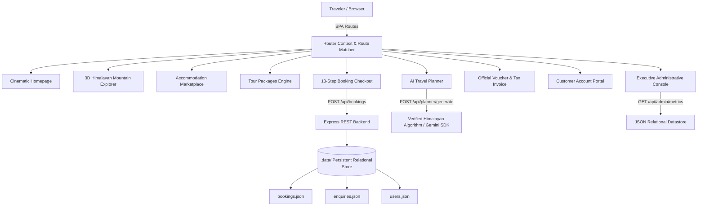

# Sikkim Tour Co. – Premier Himalayan Travel & Booking Platform

[](https://www.typescriptlang.org/)
[](https://react.dev/)
[](https://threejs.org/)
[](https://tailwindcss.com/)
[](https://expressjs.com/)
[]()

> A production-grade, immersive travel discovery and booking platform combining cinematic Himalayan storytelling, photorealistic 3D cartography, AI-powered itinerary generation, accommodation marketplace, verified booking workflows, official tax invoice generation, customer accounts, and executive administrative tools.

---

## 1. Brand & Product Vision

- **Brand Name:** Sikkim Tour Co. (Sikkim Tour Company)
- **Tagline:** *"Your Journey. Our Mountains."*
- **WhatsApp Concierge:** `+91 70018 46727` (`https://wa.me/917001846727`)
- **Email:** `info@sikkimtourcompany.com`
- **Headquarters:** Paljor Stadium Road, Gangtok, Sikkim 737101, India
- **Geographical Focus:** Sikkim & Eastern Himalayas (East, North, West, and South Sikkim).
- **Core Coverage:** Gangtok, Pelling, Lachung, Lachen, Gurudongmar Lake (17,800 ft), Yumthang Valley, Zero Point, Tsomgo Lake, Nathu La Pass, Namchi, Ravangla, Yuksom (1642 Royal Coronation Throne), Temi Organic Tea Estate, and Zuluk (32-hairpin Old Silk Route).
- **Flagship Expedition:** *Grand Sikkim Odyssey* (14-day comprehensive 4-district expedition).
- **Design Philosophy:** Photorealistic, cinematic, and premium. Deep forest green (`#173D35`), alpine white (`#F8F6F0`), charcoal (`#202724`), and restrained warm gold accents (`#C4A36A`). Typography uses Cormorant Garamond for editorial headings and Plus Jakarta Sans for interface readability.

---

## 2. Platform Architecture



---

## 3. Core Capabilities & Modules

### A. Realistic 3D Himalayan Mountain Explorer (`/3d-explorer`)
- Built with **Three.js** and WebGL, featuring procedural mountain elevation modeling Mount Kanchenjunga (28,169 ft), snow ridges, alpine valleys, and glacial lake basins.
- **11 Interactive 3D Destination Markers:** Gangtok (5,410 ft), Pelling (7,200 ft), Lachung (8,610 ft), Lachen (9,020 ft), Gurudongmar Lake (17,800 ft), Yumthang Valley (11,693 ft), Tsomgo Lake (12,313 ft), Nathu La Pass (14,140 ft), Namchi (4,314 ft), Ravangla (7,000 ft), and Zuluk (9,400 ft).
- **Smooth Camera Fly-To & Orbit Controls:** Click any pin or quick-jump selector to fly the camera to that vantage point.
- **Dynamic Lighting Modes:**
  - *Day:* Alpine daylight with clear fog.
  - *Golden Hour:* Alpenglow sunrise lighting over Mount Kanchenjunga.
  - *Night:* Moonlit starry sky with glowing snow peaks.
- **Fail-Safe Fallback:** High-resolution photographic fallback with clickable hotspot cards when WebGL is unavailable or reduced-motion is requested.

### B. Accommodation & Stays Marketplace (`/stays` & `/stays/:slug`)
- Curated luxury heritage properties, boutique mountain resorts, and authentic Sikkimese farmsteads:
  - *The Elgin Nor-Khill Gangtok* (1932 royal guesthouse)
  - *Mayfair Spa Resort & Casino* (5-star wellness)
  - *The Chumbi Mountain Retreat Pelling* (Front-row Kanchenjunga panorama)
  - *Yarlam Resort Lachung* (High-altitude heated comfort)
  - *The Apple Orchard Resort Lachen* (Base for Gurudongmar Lake)
  - *Temi Tea Heritage Estate Bungalow* (Planter bungalow in Sikkim's sole organic tea garden)
  - *Yangsum Heritage Farmstead* (1833 Bhutia family homestead)
  - *Old Silk Route Cloud Lodge Zuluk* (Above the clouds at 9,400 ft)
- Multi-facet filters: District, Property Type, Price, Amenities (Central Heating, Mountain View, Fireplace, Spa, Wi-Fi).
- Direct room category reservation connecting to the checkout flow.

### C. 13-Step Booking & Payment Engine (`/checkout` & `/booking-confirmation/:id`)
1. Selection of package, stay, or custom itinerary.
2. Travel date picker and adult/child counters.
3. Accommodation tier selection (*Standard*, *Deluxe*, *Luxury Boutique*).
4. Mountain transport selection (*Shared 4x4*, *Dedicated SUV Innova/Scorpio*, *Luxury Toyota Crysta*).
5. Curated add-ons (Portable oxygen kit, Temi tea master tasting, monastery guided walks).
6. Primary traveler identification form (Legal name, contact, identity document number for military Protected Area Permits, pickup gateway, emergency contacts).
7. Promotional code validator (`HIMALAYA10` for 10% off, `EARLYBIRD` for ₹2,500 off, `PEACEFULSIKKIM` for ₹3,000 off).
8. Transparent itemized fare breakdown (Base fare + vehicle upgrade + add-ons - discount + 5% GST).
9. Terms and cancellation policy agreement.
10. Payment simulation via online card/UPI gateway (Razorpay / Stripe) or formal Proforma Invoice request.
11. Server-side transaction validation preventing duplicate submissions.
12. Confirmed booking page with unique Booking Reference (e.g. `BK-2026-9482`).
13. **Printable / Downloadable Official Travel Voucher & Proforma Tax Invoice** complete with GSTIN, company details, traveler info, line items, assigned driver, and 24/7 emergency numbers.

### D. AI Travel Planner (`/ai-planner`)
- Wizard interface collecting starting gateway, duration (3 to 14 days), travel month, traveler type, pace, budget, accommodation preference, and interests.
- **Engine:** Connects to `@google/genai` (if `GEMINI_API_KEY` is present) and features an algorithmic Himalayan engine guaranteeing exact mountain driving hours (e.g., Gangtok to Lachung: 118 km, ~6 hrs), elevation acclimation warnings, and itemized cost calculations.
- Day-by-day interactive timeline with morning, afternoon, and evening milestones.
- 1-click "Book This Itinerary" button transferring all data directly into the checkout workflow.

### E. Customer Account Portal (`/account`)
- Real-time list of customer bookings with live status pills (`Confirmed`, `Pending`, `Cancelled`).
- View and print official travel vouchers and invoices.
- In-portal cancellation request with automated 80% refund estimation.
- Wishlist of saved tour packages and saved custom AI itineraries.
- Pre-configured demo login for evaluation:
  - **Traveler:** `traveler@example.com` / `himalayas2026`

### F. Executive Administrative Console (`/admin`)
- **Executive Metrics:** Gross Booking Volume in INR, Confirmed Expeditions count, Pending Authorizations, Active Leads, Conversion Rate %, Top Performing Circuits.
- **Bookings Management:** Filter by status, search by traveler, update status (`Pending` → `Confirmed` → `Completed` → `Cancelled`), assign mountain chauffeur and vehicle plate number, add internal notes.
- **Lead Desk:** Track customer inquiries, update status (`New`, `Contacted`, `Quotation Sent`), and launch direct WhatsApp messages.
- **Catalog Management:** Tour packages and stays inventory oversight.
- **Reviews Moderation:** Audit customer reviews and toggle the `Verified Booking` badge.
- **SEO & Integrations:** Live health monitors for sitemaps, robots.txt, and GEO manifests.
- Pre-configured admin login:
  - **Admin:** `admin@sikkimtourcompany.com` / `sikkim2026admin`

### G. SEO & GEO (Generative Engine Optimization)
- Dynamic JSON-LD structured schemas: `TravelAgency`, `TouristDestination`, `TouristAttraction`, `Product`, `Offer`, `BreadcrumbList`.
- Dynamic document title and canonical links for every single route.
- `/robots.txt`: Proper search crawler permissions, disallowing private account/admin routes.
- `/sitemap.xml`: Complete index of 40+ canonical URLs.
- `/llms.txt`: Machine-readable GEO manifest providing verified geographical altitudes, permit requirements, and seasonal travel windows to AI answer engines.

---

## 4. API Reference

| Endpoint | Method | Description |
|---|---|---|
| `/api/admin/metrics` | `GET` | Returns executive KPIs, GMV, and popular circuits |
| `/api/bookings` | `GET` | Lists all bookings (supports `?email=` filter) |
| `/api/bookings/:id` | `GET` | Returns single booking record |
| `/api/bookings` | `POST` | Validates & creates new confirmed or proforma booking |
| `/api/bookings/:id/pay` | `POST` | Simulates online payment verification & sets status to Paid |
| `/api/bookings/:id/cancel` | `PATCH` | Cancels booking and initiates 80% refund |
| `/api/bookings/:id/admin-update` | `PATCH` | Updates booking status, assigned chauffeur, and notes |
| `/api/coupons/validate` | `POST` | Validates promo codes (`HIMALAYA10`, `EARLYBIRD`, etc.) |
| `/api/coupons` | `GET` | Returns active promotional discount rules |
| `/api/planner/generate` | `POST` | Generates structured day-by-day Himalayan itinerary |
| `/api/enquiries` | `GET` | Lists customer travel lead inquiries |
| `/api/enquiries` | `POST` | Registers new customer travel lead inquiry |
| `/api/enquiries/:id/status` | `PATCH` | Updates inquiry status (`Contacted`, `Quotation Sent`, etc.) |
| `/robots.txt` | `GET` | Crawler access rules |
| `/sitemap.xml` | `GET` | XML Sitemap containing all public indexable routes |
| `/llms.txt` | `GET` | GEO entity manifest for AI search engines |

---

## 5. Getting Started & Installation

### Prerequisites
- **Node.js**: v18.0.0 or higher
- **npm** or **bun**

### Installation Steps
```bash
# 1. Clone repository & install dependencies
git clone <repository-url>
cd untitled
npm install --legacy-peer-deps

# 2. Configure environment variables (.env)
PORT=3000
APP_URL="http://localhost:3000"
GEMINI_API_KEY="" # Optional: injects Google GenAI for custom AI planner prompts

# 3. Run automated test suite (23 unit tests)
npm test

# 4. Verify TypeScript compilation
npm run lint

# 5. Start development / API server
npm run dev
```

Visit **http://localhost:3000** in your web browser.

---

## 6. Testing & Quality Assurance

The codebase includes an automated test suite executed with Node.js native test runner and `tsx`:

```bash
npm test
```

### Verified Test Suites:
- `booking.test.ts`: Base fare calculations, accommodation multipliers, vehicle upgrade surcharges, coupon validations, and Zod booking schema integrity.
- `enquiry.test.ts`: Lead enquiry validation, international/domestic phone formats, and status transitions.
- `reviews.test.ts`: Verified booking badges, star rating distributions, and author origins.
- `searchIndex.test.ts`: Fast multi-category search indexing across spots, packages, and destinations.
- `weather.test.ts`: High-altitude mountain windchill calculations and WMO satellite weather code mapping.

---

## 7. Production Launch Checklist

- [x] All 24+ core routes configured with clean URL architecture.
- [x] Photorealistic 3D Himalayan terrain rendered with Three.js and mobile-ready controls.
- [x] Static photographic fallback active when WebGL is unsupported.
- [x] Stays marketplace featuring 8 handpicked luxury & heritage properties.
- [x] 13-step booking checkout workflow with coupon engine and transparent pricing.
- [x] Printable/downloadable official travel vouchers and proforma tax invoices with QR simulation.
- [x] AI Travel Planner providing verified mountain driving times and altitude advisories.
- [x] Customer account portal with real-time booking tracking and cancellation handling.
- [x] Executive admin console with KPI metrics, chauffeur assignment, and review moderation.
- [x] Dynamic JSON-LD structured schemas (`TravelAgency`, `TouristDestination`, `Product`, etc.).
- [x] `/robots.txt`, `/sitemap.xml`, and `/llms.txt` serving valid formats.
- [x] Zero compilation errors (`npm run lint`), passing tests (`npm test`), and production build verified (`npm run build`).
